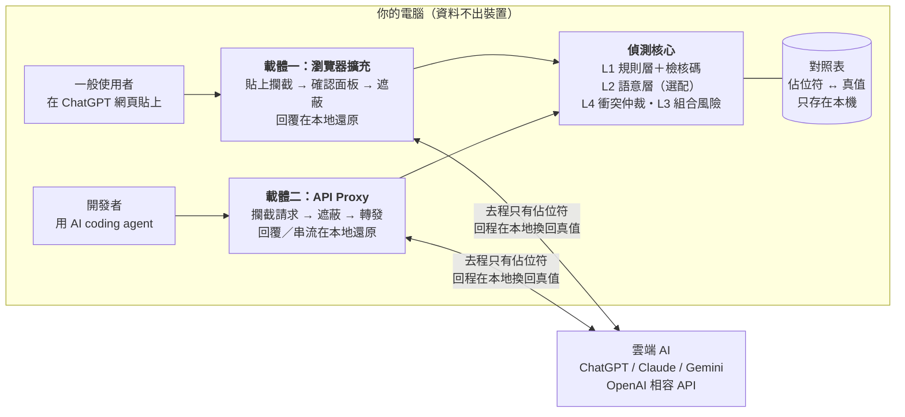
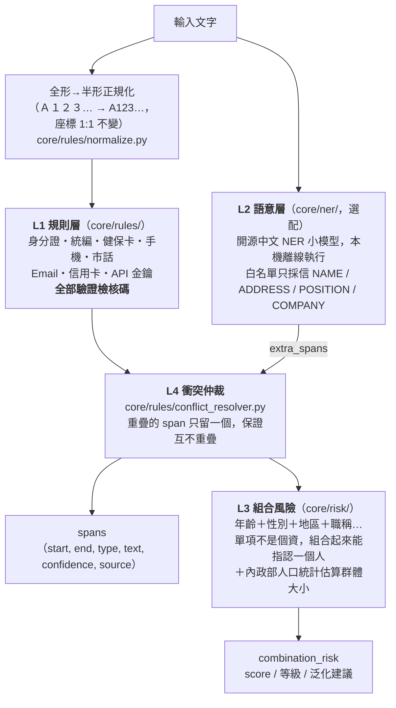
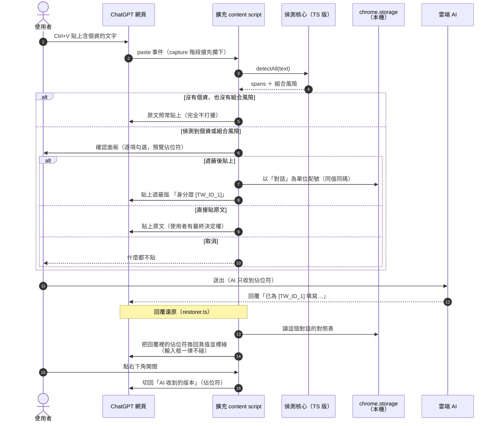
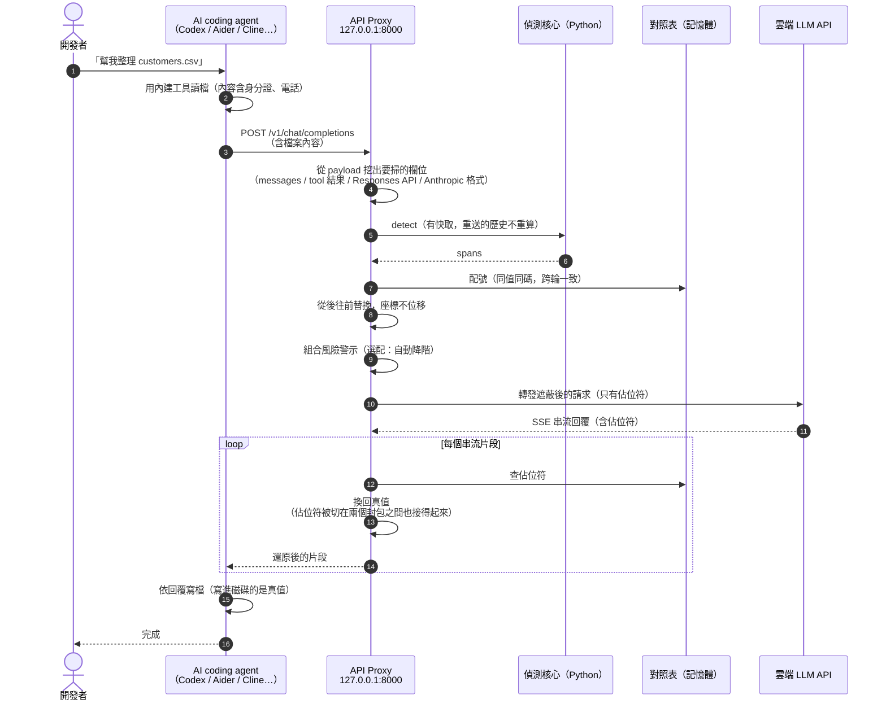
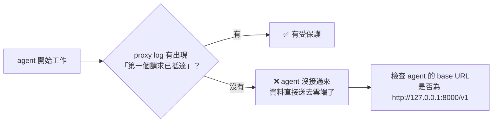
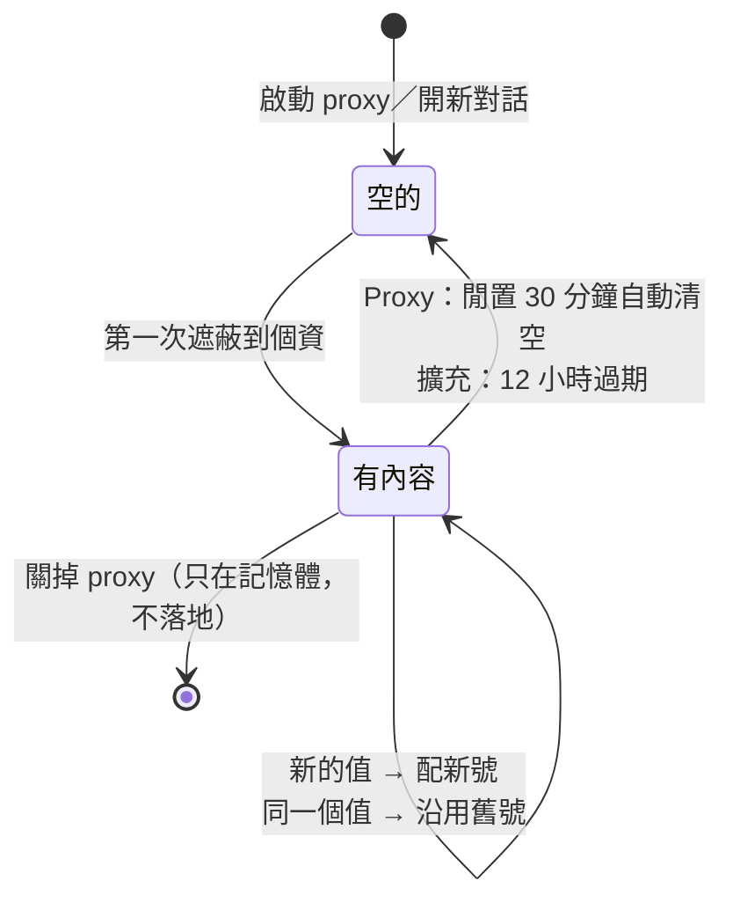
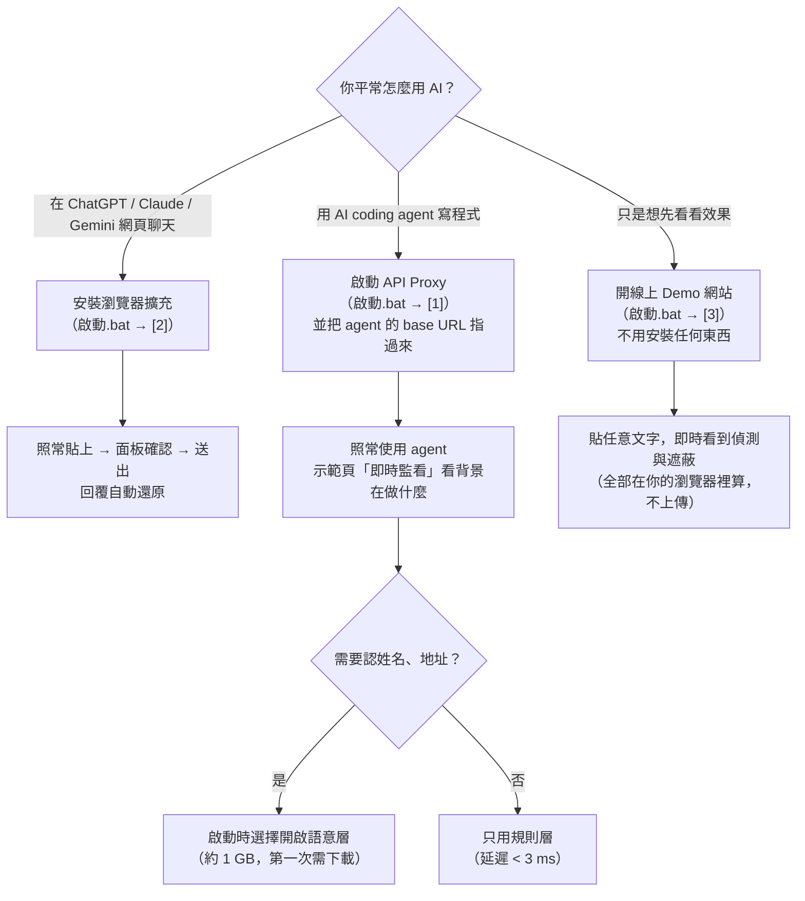
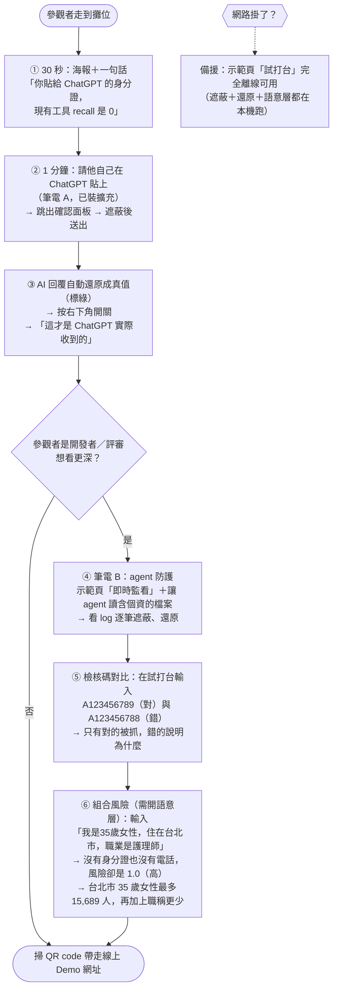

# 流程圖與工作流

> 本地端敏感資訊過濾機制（隊名：私密大師）
>
> 這份文件用圖說明系統「怎麼運作」與「怎麼使用」。每張圖的每個方塊都對得到程式碼，
> 方塊旁的檔名就是出處。GitHub 會把下面的 Mermaid 區塊直接畫成圖。
>
> 安裝與操作步驟見 [使用說明書](使用說明書.md)。

目錄

1. [系統總覽：一個核心、兩個載體](#1-系統總覽一個核心兩個載體)
2. [偵測核心：四層架構](#2-偵測核心四層架構)
3. [載體一：瀏覽器擴充的完整流程](#3-載體一瀏覽器擴充的完整流程)
4. [載體二：AI Agent 防護（API Proxy）的完整流程](#4-載體二ai-agent-防護api-proxy的完整流程)
5. [對照表的生命週期](#5-對照表的生命週期)
6. [使用者工作流：誰該用哪一個](#6-使用者工作流誰該用哪一個)
7. [Demo Day 現場展示動線](#7-demo-day-現場展示動線)

---

## 1. 系統總覽：一個核心、兩個載體

核心概念只有一句：**個資在離開你的電腦之前就被換成佔位符，AI 回覆回來時才在本地換回真值。**
雲端 AI 從頭到尾只看到 `[TW_ID_1]`，看不到 `A123456789`。

| 載體 | 給誰 | 攔截點 | 程式碼 |
|---|---|---|---|
| 瀏覽器擴充 | 一般使用者 | 網頁輸入框的 `paste` 事件 | `extension/` |
| API Proxy | 開發者 | LLM API 請求（不是 MCP） | `proxy/` |

攔截點選在 **LLM API 層**而不是 MCP，因為六款主流 agent 讀檔都走內建工具、不經過 MCP。
Aider / Continue / Cline / Codex / OpenCode / Claude Code 可攔；**Cursor 走自家後端，攔不到，誠實列為不支援。**

---

## 2. 偵測核心：四層架構

**為什麼要驗檢核碼**：Presidio、GLiNER、LLM Guard 對台灣身分證與統編的 recall 都是 0.000，
而且沒有任何工具驗檢核碼 —— 任何「1 英文＋9 數字」都會被當成身分證，誤報率高到使用者會關掉工具。
我們驗，所以 `A123456788`（檢核碼錯）不會被誤判。

**為什麼語意層預設關閉**：模型約 389 MB、套件約 1 GB，而且延遲隨文字長度成長
（38 字 43 ms → 3040 字 2265 ms）。規則層只要 0.1～3 ms。

---

## 3. 載體一：瀏覽器擴充的完整流程

**幾個刻意的設計：**

- **攔 `paste` 不攔右鍵選單**：不需要 `clipboardRead` 權限，而且使用者照常 Ctrl+V 就被保護。
- **新對話會換網址**（`/` → `/c/<id>`）：送出第一則訊息後，配號狀態跟著搬到新網址，
  否則還原會找不到對照表。只在「從新對話頁跳過去」時才搬，避免拿錯對話的對照表。
- **AI 自己編的佔位符**（例如從沒發過的 `[TW_ID_9]`）**原樣保留、絕不猜測**。

---

## 4. 載體二：AI Agent 防護（API Proxy）的完整流程

**驗證過的事實（實際跑 Codex 的紀錄，2026-08-22）**：agent 把自己寫的檔案讀回來時，
規則層在裡面**又抓到一個身分證** —— 若還原失效，檔案裡會是 `[TW_ID_1]`，不可能被判成身分證。
這是從磁碟上的位元組倒推回來的證據，不是 log 宣稱的。

**一定要確認流量真的有經過 proxy**：設定沒生效時 agent 會安靜地直連雲端，畫面上沒有任何警告。
所以 proxy 會在第一個請求抵達時印一行「第一個請求已抵達 proxy」，`/healthz` 也看得到請求數。

---

## 5. 對照表的生命週期

對照表是一份「佔位符 ↔ 真值」的明文清單，**本身就是集中的個資，是攻擊面**。
所以它只存在本機、有作用域、會自動過期。

| | API Proxy | 瀏覽器擴充 |
|---|---|---|
| 存在哪 | 行程記憶體（不寫檔） | `chrome.storage.local`（本機） |
| 作用域 | 整個 proxy 行程 | **單一對話**（換對話就換一組號碼） |
| 過期 | 閒置 30 分鐘清空（`PROXY_MAPPING_IDLE_TIMEOUT`） | 12 小時 |
| 為什麼作用域不同 | agent 每輪重送全部歷史，必須跨請求一致 | 跨對話一致的假名等於造了一個追蹤識別子 |

---

## 6. 使用者工作流：誰該用哪一個

| 角色 | 用什麼 | 需要安裝 |
|---|---|---|
| 一般上班族、學生 | 瀏覽器擴充 | Chrome |
| 開發者 | API Proxy | Python 3.11 |
| 想認姓名地址的人 | Proxy ＋ 語意層 | 再加約 1 GB 套件 |
| 評審、參觀者 | 線上 Demo 網站 | 不用 |

---

## 7. Demo Day 現場展示動線

2026-11-08（日）政大公企中心，13:00 前報到、13:30 起評比。形式是**展覽式擺攤**，現場有網路。
每位參觀者停留時間不長，動線設計成「30 秒看懂、3 分鐘看完、想深入可以一直挖」。

**現場前一天檢查清單**

- [ ] 筆電 A：Chrome 已載入最新版擴充（`啟動.bat` → `[2]` → 擴充卡片按「重新載入」）
- [ ] 筆電 A：ChatGPT 已登入，開一個新對話備用
- [ ] 筆電 B：`啟動.bat` → `[1]`，語意層選「開啟」，示範頁能打開
- [ ] 筆電 B：`.env` 已填上游金鑰，agent 指令已在 cmd 視窗準備好
- [ ] 兩台都測過一次「拔掉網路」時試打台仍能用
- [ ] 線上 Demo 網址的 QR code 印在海報上
